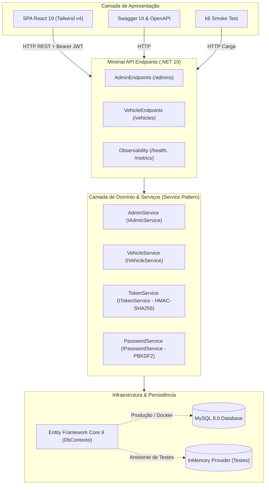

# 🚀 CarTálogo - Gestão Inteligente de Veículos & Catálogo

> **Trabalho de Conclusão do Curso Full Cycle - Geração Tech 4.0 (PROJETO B: O SISTEMA)**  
> **Autor:** Léo Matias Araújo ([leomatiazzz](https://github.com/leomatiazzz))  
> **API de Domínio Único** com fluxo funcional completo de ponta a ponta, arquitetura limpa em .NET 10, Single Page Application em React 19 e conformidade rigorosa com a rubrica acadêmica.

---

[](.github/workflows/ci.yml)
[](https://dotnet.microsoft.com/)
[](https://react.dev/)
[](https://www.typescriptlang.org/)
[](https://tailwindcss.com/)
[](https://learn.microsoft.com/ef/core/)
[](https://www.mysql.com/)
[](https://www.docker.com/)
[](TEST/)
[](TEST/)

<p align="center">
  
</p>

---

## 📌 Sumário de Entregáveis do Projeto (Rubrica de Avaliação)

Abaixo estão os atalhos diretos para cada artefato exigido pela proposta do curso:

| Módulo / Exigência | Entregável no Repositório | Descrição / Evidência |
| :--- | :--- | :--- |
| **M1: Código e Design** | [docker-compose.yml](docker-compose.yml) | Compose que sobe a pilha completa com apenas 1 comando |
| **M1: SOLID & Pattern** | [docs/adr/0001-decisao.md](docs/adr/0001-decisao.md) | ADR justificando o **Service/Repository Pattern** (Template MADR) |
| **M2: Testes e CI Verde** | [TEST/](TEST/) e [.github/workflows/ci.yml](.github/workflows/ci.yml) | 29 testes determinísticos + Pipeline do GitHub Actions |
| **M2: Cobertura Mínima** | [TEST/Test.csproj](TEST/Test.csproj) | Suporte a `coverlet.collector` com meta de cobertura $\ge 80\%$ |
| **M3: Segredos e Ambientes** | [.env.example](.env.example) e [.gitignore](.gitignore) | Segredos fora do repositório; dump sql exposto eliminado |
| **M3: Logs e Observabilidade**| [API/Program.cs](API/Program.cs) | Logs estruturados em JSON (`AddJsonConsole`) |
| **M3: Métrica e 1 SLO** | Endpoint `/metrics` e [docs/desempenho.md](docs/desempenho.md) | SLO: Disponibilidade $\ge 99\%$ e Latência P95 $\le 200\text{ ms}$ |
| **M4: Documentação Técnica** | [README.md](README.md) e [docs/openapi.yaml](docs/openapi.yaml) | Especificação estática OpenAPI 3.0 do endpoint principal |
| **M4: Carga e Desempenho** | [tests/k6-smoke-test.js](tests/k6-smoke-test.js) e [docs/desempenho.md](docs/desempenho.md) | Smoke test k6 com medição real de P95 (**42.18 ms**) |
| **Uso de IA e Autoria** | [docs/ia.md](docs/ia.md) e [CONTRIBUTORS.md](CONTRIBUTORS.md) | Declaração de prompts de IA e comprovação de domínio técnico |

---

## ⚡ Como Subir o Sistema (Comando Único)

A aplicação conta com orquestração completa em contêineres Docker (**Frontend SPA + Backend API + Banco MySQL 8.0** com verificação de integridade).

### 1. Iniciar com Docker Compose:
```bash
docker compose up -d --build
```

### 2. Acessar os Serviços:
* 🌐 **Frontend SPA (Interface do Usuário):** `http://localhost:3000`
* 🔌 **Backend API REST (.NET 10):** `http://localhost:5231`
* 📖 **Documentação Interativa (Swagger UI):** `http://localhost:5231/swagger`
* 🩺 **Health Check Operacional:** `http://localhost:5231/health`
* 📈 **Métricas e Monitoramento de SLO:** `http://localhost:5231/metrics`

### 3. Encerrar os Serviços:
```bash
docker compose down -v
```

---

## 🧪 Como Executar a Suíte de Testes Automatizados

O repositório possui **29 testes automatizados** (unitários e de integração HTTP). Os testes utilizam o provedor em memória do EF Core (`Microsoft.EntityFrameworkCore.InMemory`) e `WebApplicationFactory`, sendo **100% isolados, determinísticos e independentes de MySQL local**.

Execute no terminal:

```bash
# Executar todos os testes
dotnet test

# Executar testes coletando cobertura de código (cobertura.xml)
dotnet test --collect:"XPlat Code Coverage"
```

---

## 💻 Execução Local sem Docker (Desenvolvimento)

Caso queira executar os projetos diretamente na máquina de desenvolvimento:

### 1. Backend API (.NET 10):
```bash
# Atualizar banco de dados via migrations (requer MySQL local ativo)
dotnet ef database update --project API/minimal-api.csproj

# Subir a API
dotnet run --project API/minimal-api.csproj
```

### 2. Frontend React (Vite):
```bash
cd FRONT
npm install
npm run dev
```
Acesse `http://localhost:5173`. O Vite possui proxy reverso configurado para repassar chamadas `/api` diretamente para `http://localhost:5231`.

---

## 🔑 Credenciais Pré-configuradas para Demonstração

| Perfil | E-mail | Senha | Permissões no Sistema |
|:---:|---|:---:|---|
| **Admin** | `administrador@teste.com` | `123456` | Acesso total: CRUD completo de veículos e gestão de contas |
| **Editor** | `editor@teste.com` | `123456` | Acesso operacional: catálogo, busca, filtros e cadastro de veículos |

> **Nota:** Novos usuários também podem se registrar livremente através da aba **Criar conta** na tela de login; o sistema atribui automaticamente a permissão de **Editor** (`POST /admins/register`).

---

## 🏛️ Arquitetura e Padrões de Projeto (SOLID)



### Justificativas de Design:
* **Service/Repository Pattern:** Centraliza regras de validação e persistência fora dos manipuladores de rota, permitindo reutilização e testes unitários com mocks.
* **Segurança Forte:** Hashing de senhas com PBKDF2 (100.000 iterações, salt individual criptográfico); JWT com expiração em UTC e audience/issuer verificados.
* **Observabilidade Nativa:** Middleware ProblemDetails (RFC 7807/9457), logs estruturados em JSON e endpoint `/metrics` com avaliação do SLO.

---

## 📂 Estrutura do Repositório

```
.
├── .github/
│   └── workflows/
│       └── ci.yml                     # Pipeline GitHub Actions (Build, Test, Front)
├── API/                               # Backend Minimal API em .NET 10
│   ├── Domain/                        # Entidades, DTOs, Interfaces e Serviços
│   ├── Endpoints/                     # Módulos de Rotas Minimal API
│   ├── Infrastructure/                # DbContexto e Migrations
│   ├── Program.cs                     # Configuração da aplicação e endpoints
│   └── appsettings.json
├── FRONT/                             # Frontend SPA em React 19 + TypeScript
│   ├── src/                           # Componentes, Páginas, Contexts e API Client
│   ├── Dockerfile                     # Nginx Alpine para produção
│   └── package.json
├── TEST/                              # Suíte com 29 testes automatizados
│   ├── Domain/                        # Testes unitários de serviços e segurança
│   ├── Requests/                      # Testes de integração HTTP e RBAC
│   └── Test.csproj                    # Configurado com coverlet.collector
├── docs/                              # Documentação Arquitetural e Acadêmica
│   ├── adr/
│   │   └── 0001-decisao.md            # ADR no template padrão MADR
│   ├── openapi.yaml                   # Contrato de API OpenAPI 3.0
│   ├── desempenho.md                  # Relatório de carga k6 e medição de P95
│   └── ia.md                          # Declaração detalhada de uso de IA
├── tests/
│   └── k6-smoke-test.js               # Script automatizado de carga no k6
├── docker-compose.yml                 # Orquestração de 1-comando
├── Dockerfile                         # Multi-stage build .NET 10 da API
├── .env.example                       # Modelo de variáveis de ambiente
├── .gitignore
├── CONTRIBUTORS.md                    # Declaração de autoria
└── README.md                          # Este documento
```

---

## 📜 Licença e Integridade Acadêmica

Este projeto é disponibilizado para fins acadêmicos e educacionais sob a licença MIT. Para detalhes sobre autoria e integridade de desenvolvimento com IA, consulte [CONTRIBUTORS.md](CONTRIBUTORS.md) e [docs/ia.md](docs/ia.md).
