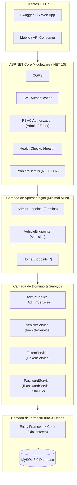

# 🚀 CarTálogo (.NET 10 & React 19) - Gestão de Veículos & Administradores

[](https://dotnet.microsoft.com/)
[](https://react.dev/)
[](https://www.typescriptlang.org/)
[](https://vitejs.dev/)
[](https://tailwindcss.com/)
[](https://learn.microsoft.com/ef/core/)
[](https://www.mysql.com/)
[](https://www.docker.com/)
[](https://jwt.io/)
[](https://learn.microsoft.com/visualstudio/test/unit-testing-mstest-runner)

<p align="center">
  
</p>

Uma plataforma SaaS completa para **gerenciamento e catálogo inteligente de veículos**, unindo uma **API REST moderna em .NET 10** e uma **Single Page Application (SPA) em React 19**, com controle de acesso granular baseado em papéis (**RBAC: Admin e Editor**), autenticação JWT e conteinerização via Docker Compose.

---

## 🏛️ Arquitetura e Design de Software

O projeto adota os princípios de **Clean Architecture**, **SOLID** e separação estrita de responsabilidades:



### Principais Destaques Arquiteturais:
1. **Minimal APIs Idiomáticas:** Sem o arquivo monolítico legado `Startup.cs`. Inicialização via `WebApplication.CreateBuilder(args)` e agrupamento modular com `app.MapGroup()`.
2. **Desacoplamento de Contrato com ViewModels/DTOs:** Nenhuma entidade interna do EF Core é exposta diretamente na API. Todas as respostas utilizam `record` imutáveis (`VehicleModelView`, `AdminModelView`).
3. **I/O 100% Assíncrono (`async/await` com `CancellationToken`):** Todas as operações de banco de dados são não-bloqueantes, prevenindo *ThreadPool Starvation*.
4. **Otimização de Consultas:** Consultas somente-leitura utilizam `.AsNoTracking()` e filtros SARGable (sem `.ToLower()` que invalidem índices do MySQL).

---

## 🔒 Segurança da Informação

* **Hash Criptográfico de Senhas (PBKDF2):** As senhas de administradores nunca são salvas ou comparadas em texto puro. Utiliza-se derivação de chave com HMAC-SHA512 e *salt* randômico por usuário (`PasswordHasher<T>` nativo do ASP.NET Core).
* **JWT Bearer Conforme RFC 7519:**
  * Assinatura com chave de alta entropia (≥ 256 bits).
  * Validação estrita de tempo de vida em UTC (`DateTime.UtcNow`), `Issuer`, `Audience` e `ClockSkew = TimeSpan.Zero`.
* **Controle de Acesso Baseado em Papéis (RBAC):**
  * `Admin`: Acesso administrativo irrestrito (CRUD de administradores e veículos).
  * `Editor`: Acesso operacional (cadastro, leitura e consulta de veículos; sem permissão de exclusão ou gestão de usuários).
* **Índices e Integridade:** Constraint `UNIQUE` na coluna `Email` de administradores para impedir cadastros duplicados.
* **Segredos Fora do Repositório:** Chaves e dados sensíveis gerenciados via variáveis de ambiente e `.gitignore` higienizado contra dumps de banco de dados.

---

## 📋 Endpoints da API

| Método | Rota | Autenticação / Role | Descrição | Status HTTP |
|---|---|:---:|---|:---:|
| `GET` | `/` | Pública | Informações da API e link da documentação | `200 OK` |
| `GET` | `/health` | Pública | Verificação de integridade (*liveness/readiness*) | `200 OK` |
| `POST` | `/admins/login` | Pública | Autenticação e emissão de Token JWT | `200 OK`, `401 Unauthorized` |
| `GET` | `/admins` | `Admin` | Listagem paginada de administradores | `200 OK`, `401`, `403 Forbidden` |
| `GET` | `/admins/{id}` | `Admin` | Busca de administrador por ID | `200 OK`, `404 Not Found` |
| `POST` | `/admins` | `Admin` | Cadastro de novo administrador | `201 Created`, `400 Bad Request` |
| `GET` | `/vehicles` | `Admin, Editor` | Listagem de veículos com filtros (`name`, `brand`, `page`) | `200 OK`, `401` |
| `GET` | `/vehicles/{id}` | `Admin, Editor` | Busca de veículo por ID | `200 OK`, `404 Not Found` |
| `POST` | `/vehicles` | `Admin, Editor` | Cadastro de novo veículo | `201 Created`, `400 Bad Request` |
| `PUT` | `/vehicles/{id}` | `Admin` | Atualização cadastral de veículo | `200 OK`, `400`, `403`, `404` |
| `DELETE` | `/vehicles/{id}` | `Admin` | Exclusão de veículo | `204 NoContent`, `403`, `404` |

---

## 🛠️ Como Executar

### Pré-requisitos
* [.NET 10.0 SDK](https://dotnet.microsoft.com/download/dotnet/10.0) e [Node.js v20+](https://nodejs.org/) ou [Docker Desktop](https://www.docker.com/)

---

### Opção 1: Execução com Docker Compose (Fullstack)

Suba toda a infraestrutura (**Frontend React + API .NET 10 + MySQL 8.0**) com um único comando:

```bash
docker compose up -d --build
```

Acesse os serviços:
* **Frontend SPA (CarTálogo Web):** `http://localhost:3000`
* **Backend API REST:** `http://localhost:5231`
* **Swagger UI:** `http://localhost:5231/swagger`
* **Health Check:** `http://localhost:5231/health`

Para encerrar o ambiente:
```bash
docker compose down -v
```

---

### Opção 2: Execução Local em Desenvolvimento

#### 1. Iniciar o Backend (.NET 10):
```bash
# Aplicar migrações no MySQL
dotnet ef database update --project API/minimal-api.csproj

# Iniciar a API (porta 5231)
dotnet run --project API/minimal-api.csproj
```

#### 2. Iniciar o Frontend (React + Vite):
Em um novo terminal:
```bash
cd FRONT
npm install
npm run dev
```
O frontend estará acessível em `http://localhost:5173` com proxy automático redirecionando chamadas `/api` para `http://localhost:5231`.

---

### 🔑 Credenciais Pré-configuradas para Testes

| Perfil | E-mail | Senha | Permissões |
|---|---|---|---|
| **Admin** | `administrador@teste.com` | `123456` | Acesso total (CRUD de veículos e gestão de administradores) |
| **Editor** | `editor@teste.com` | `123456` | Leitura, busca e cadastro de novos veículos |

---

## 🧪 Suíte de Testes Automatizados

O projeto conta com testes unitários e de integração desenvolvidos com **MSTest**, **WebApplicationFactory** e **Entity Framework Core In-Memory Provider**. Os testes são **100% determinísticos e isolados**, rodando sem necessidade de infraestrutura externa ou MySQL local.

Execute toda a suíte de testes:

```bash
dotnet test
```

### Cobertura dos Testes:
* ✅ **Testes Unitários de Segurança:** Validação de hashing PBKDF2 e comparação com salt randômico.
* ✅ **Testes Unitários de Serviços:** Operações CRUD, paginação segura e filtros de busca em `VehicleService` e `AdminService`.
* ✅ **Testes de Integração HTTP:**
  * Fluxo de autenticação (`/admins/login`) com credenciais válidas e inválidas.
  * Validação de payloads e regras de domínio (ex: ano do veículo entre 1886 e ano vigente + 1).
  * **Testes de Autorização RBAC:** Confirmação de que o perfil `Editor` recebe `403 Forbidden` ao tentar excluir veículos ou acessar dados de administradores.
  * Verificação do endpoint de integridade operacional (`/health`).

---

## 📂 Estrutura de Diretórios

```
minimal-api/
├── API/                               # Projeto Principal da API
│   ├── Domain/                        # Regras de Negócio e Domínio
│   │   ├── DTOs/                      # Data Transfer Objects de Entrada
│   │   ├── Entities/                  # Entidades do EF Core (Admin, Vehicle)
│   │   ├── Enums/                     # Enumerações (Profile: Admin, Editor)
│   │   ├── Interfaces/                # Contratos de Serviços (IAdmin, IVehicle, etc.)
│   │   ├── ModelViews/                # DTOs de Saída / ViewModels (Record)
│   │   └── Services/                  # Implementações com async/await e PBKDF2
│   ├── Endpoints/                     # Módulos Minimal API (RouteGroupBuilder)
│   │   ├── AdminEndpoints.cs
│   │   ├── VehicleEndpoints.cs
│   │   └── HomeEndpoints.cs
│   ├── Infrastructure/                # Persistência de Dados
│   │   └── Db/DbContexto.cs
│   ├── Migrations/                    # Histórico de Migrações do EF Core
│   ├── Program.cs                     # Inicialização Idiomática .NET 10
│   └── appsettings.json
│
├── TEST/                              # Suíte de Testes Automatizados
│   ├── Domain/                        # Testes Unitários de Domínio e Serviços
│   ├── Helpers/Setup.cs               # WebApplicationFactory e Gerador de Tokens JWT
│   ├── Mocks/                         # Mocks em Memória para Testes de Integração
│   └── Requests/                      # Testes de Requisições HTTP (RBAC, CRUD)
│
├── Dockerfile                         # Multi-stage build otimizado para .NET 10
├── docker-compose.yml                 # Orquestração da API e MySQL com Healthcheck
├── .dockerignore
├── .gitignore
└── minimal-api.sln                    # Solução Principal Unificada
```

---

## 📜 Licença

Distribuído sob a licença MIT. Consulte `LICENSE` para mais informações.
